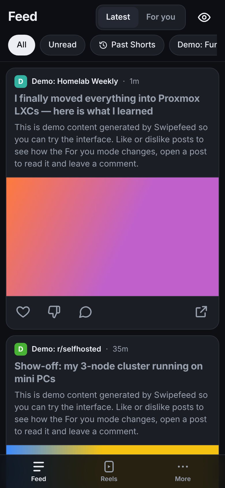
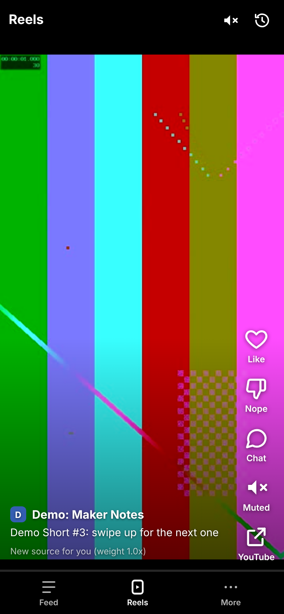
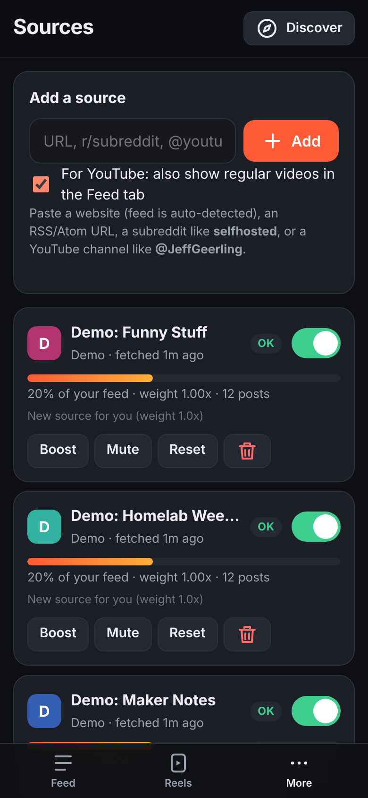
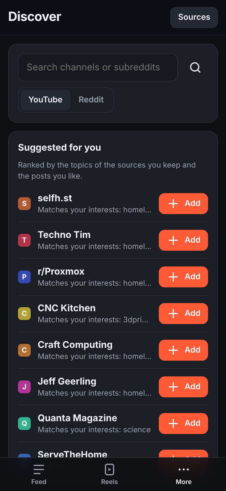
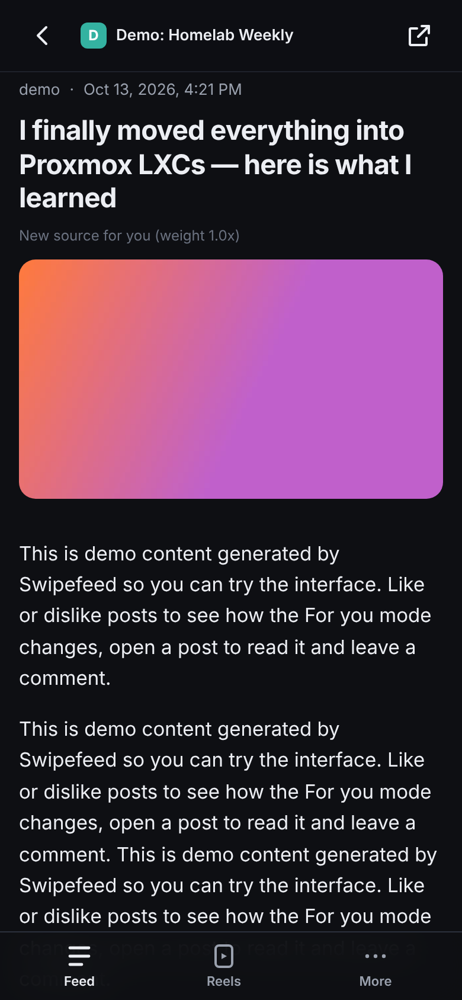
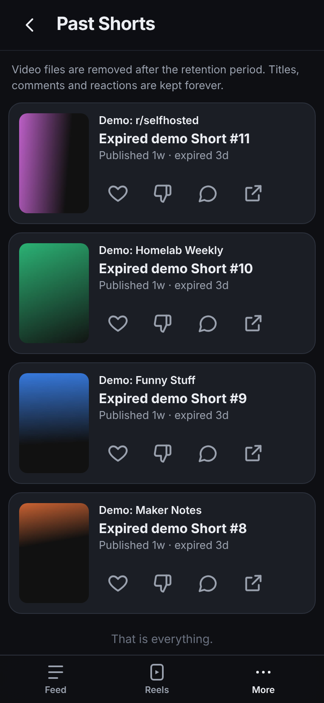
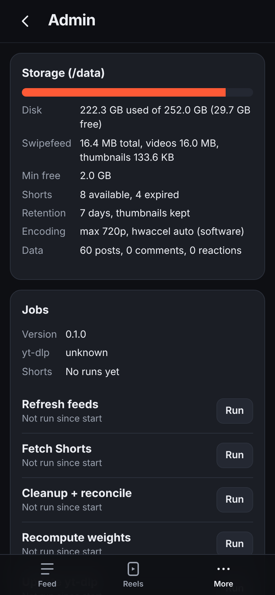
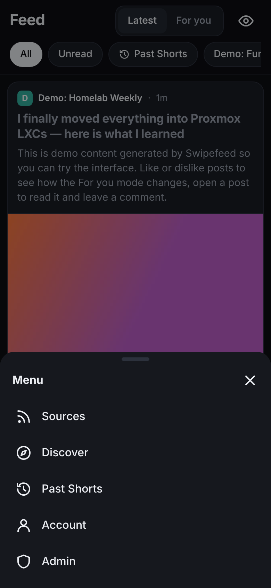

# Local DS

**Local DS** (short for *local doomscroll*) is a private, self-hosted, mobile-first feed for you and a friend.
It pulls posts from RSS/Atom feeds, subreddits and YouTube channels into one scrollable feed, downloads YouTube
Shorts to your own server for a TikTok-style swipe view, and learns from your likes and dislikes, without any
outside service ranking your content.

> **Local DS** is short for *doomscroll*. The Docker image, container and compose service are named `localds`
> (Docker names can't have spaces), so commands below use that name.

[](https://github.com/YOUR_GITHUB_USER/local-ds/actions/workflows/ci.yml)
[](LICENSE)

## Features

- **Feed:** Reddit-style cards from RSS/Atom feeds, blogs, subreddits and YouTube channels. Infinite scroll,
  *Latest* (chronological) and *For you* (personalized) modes, unread filter, a reader view, and comments.
- **Reels:** YouTube Shorts downloaded to your server and played in a full-screen vertical swipe feed. Video files
  are deleted after a few days; titles, comments and reactions are kept forever (see *Past Shorts*).
- **Likes and dislikes tune your feed, not your friend's.** Each person has their own weight per source. A dislike
  never hides a post; it just shows you less of that source over time.
- **Your own posts:** write a post (title, text, optional link) and it shows up in everyone's feed.
- **Ask AI:** connect your own LLM server (Ollama, llama.cpp, LM Studio, vLLM, or any OpenAI-compatible API) and
  summarize, fact-check or ask questions about any post or Short.
- **Your activity:** everything you liked, disliked or commented on, saved under your account, with search,
  filters, sorting and a personal **priority list** (High / Medium / Low).
- **Appearance per account:** Auto/Dark/Black/Light theme, six accent colors, three feed layouts
  (Cards, Compact, Magazine).
- **Admin tools:** invite links (no public signup), a "fetch everything now" button, disk usage, background job
  status, and yt-dlp that updates itself daily.
- **Small and self-contained:** one Docker container, SQLite, plain JavaScript with no build step. Installable on
  iOS and Android as a home-screen app (PWA).

## Screenshots

| Feed | Reels | Sources | Discover |
|---|---|---|---|
|  |  |  |  |

| Reader + comments | Past Shorts | Admin | Menu |
|---|---|---|---|
|  |  |  |  |

Screenshots come from the built-in demo data (`python -m app.seed`) via `scripts/screenshots.py`.

## Quick start

On any machine with Docker:

```bash
git clone https://github.com/YOUR_GITHUB_USER/local-ds.git && cd local-ds
cp .env.example .env          # optional: every setting has a default
docker compose up -d --build
```

Open `http://<host>:8080` (or the `PORT` you set in `.env`). The first visit asks you to create the admin
account. Then add sources under **More → Sources**, or pick some from **Discover**.

Want to look around first? Load demo posts, test videos and two demo users:

```bash
docker compose exec -u 1000:1000 localds python -m app.seed --users   # demo / demo-password (admin), friend / friend-password
docker compose exec -u 1000:1000 localds python -m app.seed --remove  # remove the demo content again
```

For a proper install on Proxmox (Debian 12 LXC, one-command installer, iGPU encoding), see
**[docs/INSTALL.md](docs/INSTALL.md)**. To reach it from your phone over HTTPS, see
**[docs/REMOTE_ACCESS.md](docs/REMOTE_ACCESS.md)**. Do not port-forward it to the internet.

## Documentation

Everything is documented so the project can be run, fixed and extended by a person reading the code, without
relying on any outside help.

| Doc | Read it when you want to… |
|---|---|
| [docs/README.md](docs/README.md) | find your way around the docs; glossary |
| [docs/USER_GUIDE.md](docs/USER_GUIDE.md) | learn every screen and feature |
| [docs/INSTALL.md](docs/INSTALL.md) | install on Proxmox/Docker, first run, iGPU encoding |
| [docs/REMOTE_ACCESS.md](docs/REMOTE_ACCESS.md) | use it from your phone and a friend's (Tailscale, Cloudflare Tunnel) |
| [docs/OPERATIONS.md](docs/OPERATIONS.md) | update, back up, restore, reset a password, look inside the database |
| [docs/AI.md](docs/AI.md) | connect an LLM server for Ask AI |
| [docs/CONFIGURATION.md](docs/CONFIGURATION.md) | look up any `.env` setting |
| [docs/TROUBLESHOOTING.md](docs/TROUBLESHOOTING.md) | fix something that broke (Reddit limits, yt-dlp, iPhone playback, …) |
| [docs/ARCHITECTURE.md](docs/ARCHITECTURE.md) | understand how the whole thing fits together |
| [docs/DATABASE.md](docs/DATABASE.md) | understand the tables, rules and migrations |
| [docs/API.md](docs/API.md) | see every HTTP endpoint with its inputs and outputs |
| [docs/PERSONALIZATION.md](docs/PERSONALIZATION.md) | understand the ranking math (weights, For you, Reels, exploration) |
| [docs/FEEDS_AND_SHORTS.md](docs/FEEDS_AND_SHORTS.md) | understand fetching, Reddit batching, yt-dlp, transcoding, retention |
| [docs/FRONTEND.md](docs/FRONTEND.md) | change the UI: app.js structure, CSS, themes, layouts, PWA caching |
| [docs/DEVELOPMENT.md](docs/DEVELOPMENT.md) | set up a dev environment, run tests, follow step-by-step recipes for common changes, release |
| [CONTRIBUTING.md](CONTRIBUTING.md) / [SECURITY.md](SECURITY.md) / [CHANGELOG.md](CHANGELOG.md) | contribute, report a vulnerability, see what changed |

## Tech stack

Python 3.12, FastAPI, uvicorn (single worker), SQLite in WAL mode, APScheduler for background jobs, feedparser,
BeautifulSoup, httpx, argon2, yt-dlp and ffmpeg. The frontend is one ES module (`app/static/app.js`) and one
stylesheet, with no framework and no build step.

## License

[MIT](LICENSE). Local DS downloads videos with yt-dlp for private viewing; respect the content's terms and copyright
in your jurisdiction.

> Before publishing a fork, replace `YOUR_GITHUB_USER` in this README, `install.sh`, `.env.example`, the docs and
> `scripts/proxmox-create-lxc.sh` with your GitHub user name.
