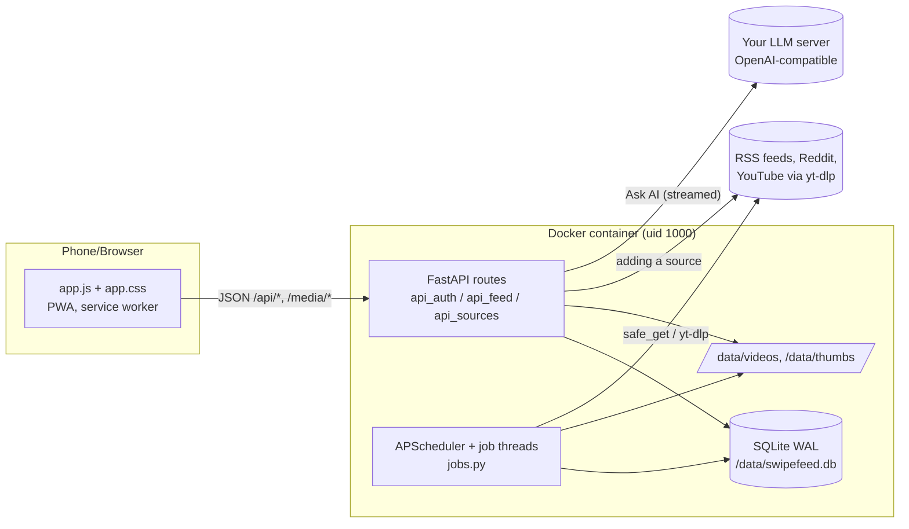
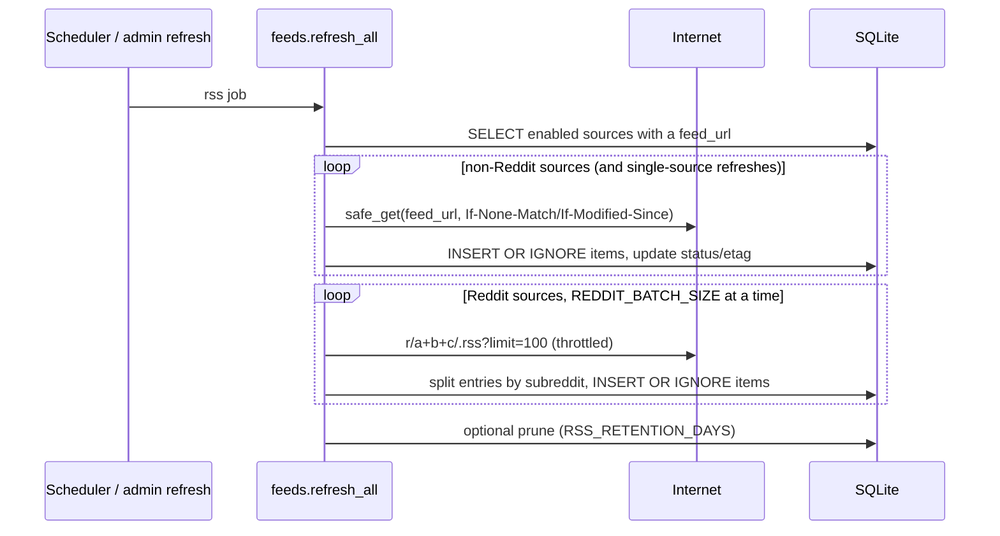
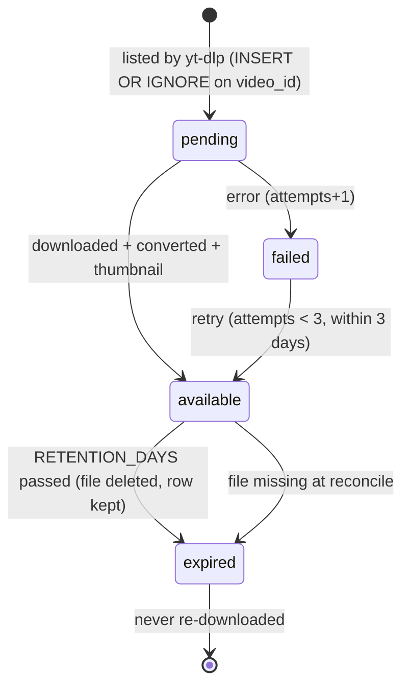

# Architecture

Local DS is **one Python process** (FastAPI on uvicorn, a single worker) inside **one container**. That process
serves the JSON API, the static frontend and the video files, and runs all background jobs in threads. All state
is in SQLite and a few folders under `/data`. There is no Redis, no message queue, no separate worker, and no
frontend build step.

- [The big picture](#the-big-picture)
- [Startup sequence](#startup-sequence)
- [What happens on a request](#what-happens-on-a-request)
- [Module map](#module-map)
- [Background jobs](#background-jobs)
- [Concurrency and why there is only one worker](#concurrency-and-why-there-is-only-one-worker)
- [Main data flows](#main-data-flows)
- [Security layers](#security-layers)
- [Rules the code must keep](#rules-the-code-must-keep)

---

## The big picture



```
/data
├── swipefeed.db (+ -wal, -shm)   SQLite database, WAL mode
├── .secret_key                   generated SECRET_KEY if none is configured
├── videos/<video_id>.mp4         downloaded Shorts, deleted after RETENTION_DAYS
├── thumbs/<video_id>.jpg         thumbnails, kept unless KEEP_THUMBNAILS=false
├── tmp/<video_id>/               work folder for a download in progress
└── demo/                         demo images (only with demo data)
```

## Startup sequence

1. **Entrypoint** ([docker/entrypoint.sh](../docker/entrypoint.sh)) fixes `/data` ownership, joins the GPU render
   group, drops to uid 1000 and runs `uvicorn --factory app.main:create_app` with proxy headers enabled.
2. **`create_app()`** ([app/main.py](../app/main.py)):
   1. `load_settings()` reads the environment ([CONFIGURATION.md](CONFIGURATION.md)); generates/stores a secret
      key if needed.
   2. Sets up logging, creates the data folders.
   3. `init_db()` runs the schema (`CREATE TABLE IF NOT EXISTS …`), then `_migrate()` adds any columns that older
      databases lack ([DATABASE.md](DATABASE.md#migrations)).
   4. Registers the security middleware, the three routers, `/healthz`, static files, `/sw.js`,
      `/manifest.webmanifest` and `/`.
3. **Lifespan start** (when uvicorn starts serving):
   1. `retention.reconcile()` makes disk and database agree (both directions).
   2. `retention.cleanup()` expires videos past retention.
   3. `jobs.start_scheduler()` starts the background jobs (unless `SCHEDULER_ENABLED=false`).

There is **no module-level `app`** object; always use the factory (`--factory app.main:create_app`). Tests call
`create_app(Settings(...))` with a temporary data folder.

## What happens on a request

1. **Middleware** (`security_middleware` in `main.py`):
   - For `POST/PUT/PATCH/DELETE` on `/api/*`: the `X-CSRF-Token` header must equal the `sf_csrf` cookie
     (double-submit CSRF). Otherwise 403.
   - Adds security headers (CSP, `X-Frame-Options: DENY`, `nosniff`, referrer and permissions policy) and
     `Cache-Control: no-store` on API responses.
2. **Dependencies** ([app/deps.py](../app/deps.py)):
   - `get_db` opens a **new SQLite connection per request** and closes it afterwards.
   - `current_user` looks up the `sf_session` cookie (an HMAC of the token is stored in `sessions`); 401 if
     missing or expired.
   - `admin_user` additionally requires `is_admin`; 403 otherwise.
3. **Route handler** runs. Most handlers are plain `def` functions, so FastAPI runs them in its thread pool.
   Handlers that call slow network code (`POST /api/sources`, Discover search) are `async` and push the work to
   a thread with `run_in_threadpool`.
4. Responses are JSON (Pydantic models validate request bodies; errors are `{"detail": "..."}`) except
   `/media/*` (video bytes with HTTP Range support, thumbnails) and the static files.

## Module map

| Module | Responsibility | Key names |
|---|---|---|
| [`config.py`](../app/config.py) | Settings dataclass from env | `load_settings()`, `reddit_user_agent()` |
| [`db.py`](../app/db.py) | Schema, migrations, connections, transactions, kv store | `SCHEMA`, `ADDED_COLUMNS`, `init_db()`, `connect()`, `tx()`, `kv_get/kv_set`, `now()` |
| [`security.py`](../app/security.py) | Passwords, sessions, CSRF, login rate limiting | `hash_password`, `create_session`, `session_user`, `csrf_ok`, `LoginRateLimiter` |
| [`deps.py`](../app/deps.py) | FastAPI dependencies | `get_db`, `get_settings`, `current_user`, `admin_user`, `client_ip` |
| [`main.py`](../app/main.py) | App factory, middleware, static routes | `create_app()`, `CSP` |
| [`api_auth.py`](../app/api_auth.py) | Setup, login, logout, invites, register, password, prefs | `user_public()`, `/api/state`, `/api/me/prefs` |
| [`api_feed.py`](../app/api_feed.py) | Feed, items, seen, Reels, Past Shorts, reactions, activity (filters, priority list), user posts, comments, media | `ITEM_SELECT`, `FEED_WHERE`, `_foryou_order()`, `reels_order()`, `item_json()`, `short_json()` |
| [`api_sources.py`](../app/api_sources.py) | Sources CRUD, Discover, admin endpoints | `_sources_payload()`, `admin_status()` |
| [`sources.py`](../app/sources.py) | Turn user input into a source row | `add_source()` |
| [`feeds.py`](../app/feeds.py) | Input classification, feed parsing, discovery, fetching, Reddit batching, backoff | `classify_input`, `parse_feed`, `discover_feed`, `fetch_source`, `fetch_reddit_batch`, `refresh_all` |
| [`urlsafe.py`](../app/urlsafe.py) | SSRF protection for every user-supplied URL | `validate_url`, `safe_get` |
| [`sanitize.py`](../app/sanitize.py) | Allowlist HTML sanitizer for feed content | `clean_html`, `html_to_text`, `excerpt`, `first_image` |
| [`shorts.py`](../app/shorts.py) | yt-dlp listing/downloading, ffmpeg transcode, thumbnails, yt-dlp updates | `list_channel_shorts`, `download_short`, `transcode`, `fetch_all_shorts`, `update_ytdlp` |
| [`retention.py`](../app/retention.py) | Expire old video files, reconcile disk vs DB, disk usage | `cleanup`, `reconcile`, `expire_short`, `disk_usage` |
| [`locks.py`](../app/locks.py) | Which videos are being downloaded/streamed (never delete those) | `guard.streaming()`, `guard.downloading()`, `guard.busy()` |
| [`personalization.py`](../app/personalization.py) | Score/weight math, reactions, ordering helpers | `compute_score`, `weight_from_score`, `react`, `weighted_shuffle`, `mix_exploration`, `why_line` |
| [`ai.py`](../app/ai.py) | Ask AI: post context, linked-article text, prompt, streaming LLM calls | `item_context`, `article_text`, `build_messages`, `stream_chat`, `list_models` |
| [`api_ai.py`](../app/api_ai.py) | Ask AI routes | `POST /api/ai/ask` (streaming), `POST /api/admin/ai/test` |
| [`discovery.py`](../app/discovery.py) | Starter list, topic affinity, suggestions, Reddit search | `STARTER`, `suggested`, `search_reddit` |
| [`jobs.py`](../app/jobs.py) | Scheduler wiring, job status, one-off background jobs | `start_scheduler`, `submit`, `rss_job`, `shorts_job`, … |
| [`seed.py`](../app/seed.py) | Demo data CLI | `python -m app.seed [--users] [--remove] [--no-videos]` |
| [`static/`](../app/static) | The whole frontend | see [FRONTEND.md](FRONTEND.md) |

## Background jobs

Defined in [app/jobs.py](../app/jobs.py). Each job opens its own database connection, records its status in the
in-memory `job_status` dict (shown on the Admin page) and its start time in the `kv` table.

| Job id | Function | Schedule | First run after start |
|---|---|---|---|
| `rss` | `feeds.refresh_all` | every `RSS_INTERVAL_MIN` (20 min) | 15 s |
| `shorts` | `shorts.fetch_all_shorts` | every `SHORTS_INTERVAL_MIN` (120 min) | 90 s |
| `cleanup` | `retention.reconcile` + `retention.cleanup` | hourly | (already ran at startup) |
| `weights` | `personalization.recompute_all` | daily 03:30 (container time, UTC unless `TZ` is set) | — |
| `ytdlp_update` | `shorts.update_ytdlp` | every 24 h | 30 s |
| `icons` | `icons.refresh` (15 sources per run) | every 6 h, and right after a source is added | 150 s |

Scheduler options: `coalesce=True`, `max_instances=1`, `misfire_grace_time=600`, so a slow job never runs twice
at once and missed runs are merged.

**One-off jobs** (adding a source, Refresh buttons, Admin *Run*, the admin refresh) go through `jobs.submit()`, a
`ThreadPoolExecutor` with 2 workers, so the HTTP request returns immediately.

## Concurrency and why there is only one worker

Several things live in process memory and would break with multiple uvicorn workers:

- the APScheduler instance (jobs would run once per worker),
- `locks.guard` (which video files are in use; cleanup in one worker couldn't see streams in another),
- the For-you order cache in `api_feed.py`,
- the login rate limiter,
- `feeds.reddit_throttle` and the Shorts `_fetch_lock`.

So: **always one worker.** Concurrency inside that worker:

- Request handlers run in FastAPI's thread pool; jobs run in scheduler and executor threads.
- **SQLite** is opened per request/job, in WAL mode (readers don't block the writer), autocommit
  (`isolation_level=None`), `busy_timeout=30000`. Multi-statement writes use `with tx(conn):`, which issues
  `BEGIN IMMEDIATE` so the write lock is taken up front.
- `reddit_throttle` keeps ≥3 s between Reddit requests across all threads.
- `shorts._fetch_lock`: a full Shorts run is skipped if one is already running; a run for one new channel waits.

## Main data flows

### A feed refresh



Failures set `status`, `last_error` and `backoff_until` on the source. Details: [FEEDS_AND_SHORTS.md](FEEDS_AND_SHORTS.md).

### A Short's life



### A reaction

`POST /api/react` → `personalization.react()` (one transaction): upsert or delete the `reactions` row, update the
Short's like/dislike counters, and `recompute_weight()` for this user and the item's source. Then the For-you cache
for that user is dropped so the next page uses the new weight. Details: [PERSONALIZATION.md](PERSONALIZATION.md).

### A feed page

`GET /api/feed?mode=latest` is a keyset-paginated SQL query (`published_at DESC, id DESC`). `mode=foryou` builds
an ordered list of item ids once per "snapshot" (the cursor carries the time, a random seed and an offset), caches
it in memory (32 entries), and pages through it. Details: [PERSONALIZATION.md](PERSONALIZATION.md#for-you-feed).

## Security layers

| Threat | Defense | Where |
|---|---|---|
| Password guessing | argon2 hashes; 5 failures per username / 20 per IP per 15 min | `security.py`, `api_auth.py` |
| Stolen session token in a DB leak | Only `HMAC-SHA256(SECRET_KEY, token)` is stored | `security.token_hash` |
| CSRF | Double-submit token: `sf_csrf` cookie (SameSite=Strict) must equal the `X-CSRF-Token` header | `main.py` middleware |
| Session theft over HTTP | httpOnly, SameSite=Lax session cookie, Secure when HTTPS | `api_auth._set_session_cookie` |
| Strangers signing up | No public signup: single-use, expiring, HMAC-stored invite tokens | `api_auth.py` |
| SSRF (making the server fetch your LAN) | Every user-supplied URL is resolved and must be public; re-checked on every redirect; 8 MB size cap | `urlsafe.safe_get` |
| XSS from feed content | Allowlist sanitizer (no scripts, styles, iframes, event attributes; only http(s) links); everything else is inserted as text | `sanitize.py`, `h()` in `app.js` |
| XSS in general | Strict CSP: `script-src 'self'`, no inline scripts | `main.CSP` |
| Clickjacking | `frame-ancestors 'none'`, `X-Frame-Options: DENY` | `main.py` |
| Private media leaking | `/media/*` requires login | `api_feed.py` |
| Feed text steering the AI | The model only gets text; its answer is shown as plain text (`textContent`), never as HTML. The LLM server URL comes from `.env`, not from users |
| Running as root | Entrypoint drops to uid 1000 | `entrypoint.sh` |

See also [SECURITY.md](../SECURITY.md) for the reporting policy and deployment advice.

## Rules the code must keep

These invariants are relied on by users and covered by tests. Don't break them without a very good reason:

1. **Never automatically delete comments, reactions or Short rows.** Cleanup only deletes video (and preview)
   files, sets `status='expired'` and clears `file_path`. (Explicit user actions, like deleting your own post,
   may remove things.)
2. **Never re-download a known video id**, including expired ones (`INSERT OR IGNORE` on `shorts.video_id`).
3. **No `available` row without a file**; `reconcile()` fixes both directions on startup and hourly.
4. **Cleanup skips files in `locks.guard`** (downloading, streaming, or streamed in the last 180 s).
5. **Downloading ignores weights.** Weights only change ordering.
6. **Weights are per user** and always recomputable from the `reactions` rows. Reset sets `reset_at`; it never
   deletes reactions.
7. **A dislike never hides an item.** It lowers the source weight for that user. Mute is the way to hide a source.
8. **Deleting a source keeps items that have comments or reactions** (the source is archived as `status='removed'`).
9. **Every fetch of a user-supplied URL goes through `urlsafe.safe_get` / `validate_url`.**
10. **Frontend: user and feed text goes in with `textContent`** (the `h()` helper). Only server-sanitized
    `content_html` uses `innerHTML`. Keep the strict CSP (no inline scripts).
11. **All unsafe `/api/*` requests need the CSRF header.**
12. **User posts live in a per-user `kind='user'` source**; RSS retention never prunes them.
13. **Mobile rules:** `100dvh`, safe-area insets, inputs ≥16 px (no iOS zoom), tap targets ≥44 px, no horizontal
    scroll. Reels: scroll-snap, only the current and next video get a `src`, muted autoplay, `playsinline`.
