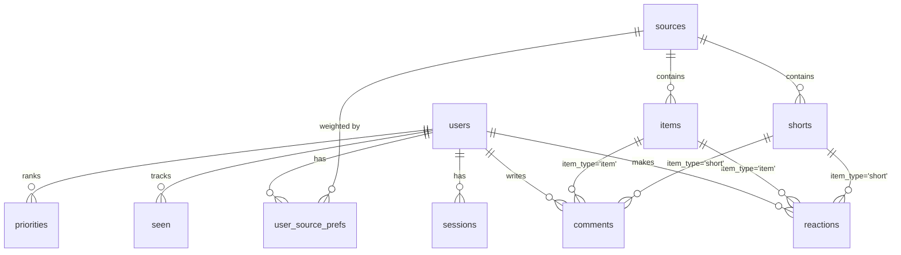

# Database

One SQLite file: `/data/swipefeed.db`, in **WAL** mode (you'll also see `-wal` and `-shm` files next to it; they
belong to it). The schema is the `SCHEMA` string in [app/db.py](../app/db.py). Times are **Unix epoch seconds as
floats** (`db.now()` = `time.time()`).

- [Connections and transactions](#connections-and-transactions)
- [Tables](#tables)
- [Relationships](#relationships)
- [Data rules](#data-rules)
- [Migrations](#migrations)
- [Handy queries](#handy-queries)

---

## Connections and transactions

`db.connect(path)` returns a connection with:

- `isolation_level=None` → **autocommit**: every statement commits on its own.
- `row_factory = sqlite3.Row` → rows behave like dicts (`row["title"]`).
- `PRAGMA foreign_keys = ON`, `busy_timeout = 30000` (wait up to 30 s for a lock), `synchronous = NORMAL`.

Group several writes into one atomic transaction with:

```python
from app.db import tx

with tx(conn):  # BEGIN IMMEDIATE ... COMMIT (ROLLBACK on exception)
    conn.execute(...)
    conn.execute(...)
```

`BEGIN IMMEDIATE` takes the write lock at the start, which avoids "database is locked" upgrade deadlocks between
threads.

## Tables

### `users`

| Column | Type | Notes |
|---|---|---|
| `id` | INTEGER PK | |
| `username` | TEXT UNIQUE, NOCASE | 3–32 chars `[A-Za-z0-9_.-]` |
| `pw_hash` | TEXT | argon2 hash |
| `is_admin` | INTEGER 0/1 | The setup user is admin |
| `feed_mode` | TEXT | `latest` or `foryou` (last used) |
| `hide_seen` | INTEGER 0/1 | Unread filter on |
| `muted` | INTEGER 0/1 | Reels sound default |
| `theme` | TEXT | `system`, `dark`, `black`, `light` (added in 0.3.0) |
| `accent` | TEXT | `ember`, `ocean`, `forest`, `grape`, `rose`, `gold` (0.3.0) |
| `layout` | TEXT | `cards`, `compact`, `magazine` (0.3.0) |
| `created_at` | REAL | |

### `sessions`

| Column | Notes |
|---|---|
| `token_hash` PK | `HMAC-SHA256(SECRET_KEY, cookie token)`; the raw token is never stored |
| `user_id` | → users, cascade delete |
| `created_at`, `expires_at` | Expired rows are deleted whenever a new session is created |
| `user_agent` | First 200 chars, informational |

### `invites`

`token_hash` PK (HMAC like sessions), `created_by`, `created_at`, `expires_at`, `used_by`, `used_at`, `note`.
An invite is valid while `used_at IS NULL AND expires_at > now`.

### `sources`

Shared by all users.

| Column | Notes |
|---|---|
| `kind` | `rss`, `reddit`, `youtube`, `demo`, `user` (a user's own posts) |
| `title` | Display name; for `user` sources the author's username |
| `feed_url` | RSS/Atom URL. Unique when not NULL. NULL for `user` and `demo` |
| `site_url`, `icon_url` | From the feed |
| `channel_id`, `channel_url` | YouTube only. `channel_id` unique when not NULL |
| `rss_enabled` | Show this source's posts in the Feed (YouTube: regular videos) |
| `shorts_enabled` | Download Shorts (YouTube only) |
| `enabled` | Global on/off (affects everyone) |
| `topics` | Comma-separated tags used by Discover suggestions |
| `status` | `new`, `ok`, `error`, `rate_limited`, `blocked`, `removed` (archived after delete) |
| `last_fetched`, `last_error`, `error_count`, `backoff_until` | Fetch health and backoff |
| `etag`, `last_modified` | HTTP caching for single-source fetches |
| `created_by` | User who added it. For `kind='user'` this is **the author**, used to find "my" source |
| `created_at` | |

### `items`

Feed posts (RSS entries, Reddit posts, YouTube video entries, user posts, demo posts).

| Column | Notes |
|---|---|
| `source_id` | → sources, cascade delete |
| `guid` | Entry id from the feed (`post:<uid>:<time>` for user posts). **`UNIQUE(source_id, guid)`** makes re-fetching idempotent |
| `url` | Link to the original (NULL for a user post without link) |
| `title`, `author`, `excerpt` | Plain text |
| `content_html` | **Sanitized** HTML (only this is ever rendered as HTML) |
| `image_url` | Card image |
| `published_at` | Used for ordering; clamped to "now" if the feed claims a future date |
| `fetched_at` | |

### `shorts`

One permanent row per YouTube Short.

| Column | Notes |
|---|---|
| `video_id` | 11-char YouTube id, **UNIQUE**: a known id is never downloaded again |
| `source_id` | → sources, SET NULL on delete |
| `title`, `channel_name`, `channel_id`, `url` | Metadata |
| `published_at`, `downloaded_at`, `expired_at` | |
| `file_path`, `thumb_path`, `preview_path` | File **names** inside `/data/videos` / `/data/thumbs` (`preview_path` is reserved, unused) |
| `duration`, `width`, `height` | From ffprobe |
| `status` | `pending` → `available` → `expired`, or `failed` |
| `attempts`, `error` | Download retries (max 3) |
| `like_count`, `dislike_count` | Denormalized counters, recomputed on every reaction |

### `reactions`

| Column | Notes |
|---|---|
| `user_id` | → users, cascade |
| `item_type` | `item` or `short` |
| `item_id` | id in `items` or `shorts` (no FK because it points at two tables) |
| `source_id` | Copied from the item at reaction time, so weights can be computed per source quickly |
| `value` | `+1` like, `-1` dislike (removing a reaction deletes the row) |
| `created_at` | Updated when the value changes; drives decay |

Primary key `(user_id, item_type, item_id)`: one reaction per user per thing.

### `comments`

`id`, `user_id` (SET NULL when the user is deleted → shown as *[deleted user]*), `item_type`, `item_id`, `body`
(≤2000 chars), `created_at`. Flat, no threads.

### `attachments`

Files attached to user posts. `token` (random, unique; the file is `/data/uploads/<token><ext>` and is served at
`/media/upload/<token>`), `user_id`, `item_id` (NULL while the post is being written; CASCADE), `filename`
(original name), `ext`, `mime`, `kind` (`image|video|audio|file`), `size`, `created_at`. Deleting the post
deletes rows and files; unattached uploads older than a day are removed by the hourly cleanup job.

### `seen`

`(user_id, item_type, item_id)` PK + `seen_at`. Drives the Unread filter and the Reels unseen-first order.

### `user_source_prefs`

Per user, per source: `weight` (cached), `score` (cached), `manual` (`NULL`/`boost`/`mute`), `reset_at`,
`updated_at`. **The cached columns can always be recomputed from `reactions`**; `manual` and `reset_at` are the
only real user input here.

### `priorities`

A user's personal priority list (added in 0.4.0): `(user_id, item_type, item_id)` PK, `level` (1 high, 2 medium,
3 low), `updated_at`. A row exists only while a priority is set; choosing "Remove priority" deletes it. Removed
together with a deleted user post.

### `kv`

Small key/value store: `schema_version`, `ytdlp_version`, `ytdlp_checked_at`, `shorts_status`,
`job:<name>` (last start time of each job).

## Relationships



## Data rules

See [ARCHITECTURE.md → Rules](ARCHITECTURE.md#rules-the-code-must-keep). The database-specific ones:

- Background jobs never delete `comments`, `reactions` or `shorts` rows.
- Deleting a source deletes only its items **without** comments or reactions; if anything remains the source is
  set to `status='removed', enabled=0` instead of being deleted.
- Deleting a user cascades their sessions, reactions, seen state and prefs, but keeps their comments
  (`user_id` → NULL).
- Deleting a user post (by its author or an admin) deletes the item **and** its comments, reactions, seen and
  priority rows,
  then recomputes affected users' weights.
- Inserting items and Shorts always uses `INSERT OR IGNORE`, so repeated fetches are harmless.

## Migrations

There is no migration framework. Two mechanisms cover everything so far:

1. **New tables or indexes**: add them to `SCHEMA` with `CREATE TABLE IF NOT EXISTS` / `CREATE INDEX IF NOT
   EXISTS`. `init_db()` runs `SCHEMA` on every start, so existing databases get them automatically.
2. **New columns on an existing table**: `CREATE TABLE IF NOT EXISTS` does nothing for a table that exists, so:
   - add the column to the `CREATE TABLE` in `SCHEMA` (for fresh databases), **and**
   - add a line to `ADDED_COLUMNS` in `db.py` (for existing databases):

     ```python
     ADDED_COLUMNS = [
         ("users", "theme", "TEXT NOT NULL DEFAULT 'system'"),
         # ... existing entries ...
         ("sources", "my_new_column", "INTEGER NOT NULL DEFAULT 0"),
     ]
     ```

   - bump `SCHEMA_VERSION` (informational; stored in `kv`).

   `_migrate()` checks `PRAGMA table_info` and runs `ALTER TABLE … ADD COLUMN` for anything missing. SQLite only
   allows `ADD COLUMN` with a constant default (or nullable), so always give a `DEFAULT`.

For anything harder (renaming/removing columns, changing types), write a one-off step in `_migrate()` guarded by
a check (e.g. `kv_get(conn, "schema_version")`), test it against a copy of a real database, and take a backup
before deploying. Add a test like `test_theme_prefs_and_migration` in `tests/test_posts.py`.

## Handy queries

Run them with the helper from [OPERATIONS.md](OPERATIONS.md#looking-inside-the-database).

```sql
-- Sources with problems
SELECT id, kind, title, status, error_count, datetime(backoff_until,'unixepoch') AS retry, last_error
FROM sources WHERE status NOT IN ('ok','new');

-- Posts per source
SELECT s.title, COUNT(i.id) FROM sources s LEFT JOIN items i ON i.source_id=s.id GROUP BY s.id ORDER BY 2 DESC;

-- Shorts by status
SELECT status, COUNT(*) FROM shorts GROUP BY status;

-- Failed downloads and why
SELECT video_id, attempts, error FROM shorts WHERE status='failed' ORDER BY created_at DESC LIMIT 20;

-- One user's weights
SELECT s.title, p.weight, p.score, p.manual, datetime(p.reset_at,'unixepoch')
FROM user_source_prefs p JOIN sources s ON s.id=p.source_id
WHERE p.user_id=(SELECT id FROM users WHERE username='demo') ORDER BY p.weight DESC;

-- Recent comments
SELECT datetime(c.created_at,'unixepoch'), u.username, c.item_type, c.item_id, substr(c.body,1,60)
FROM comments c LEFT JOIN users u ON u.id=c.user_id ORDER BY c.created_at DESC LIMIT 20;

-- Clear a source's backoff by hand
UPDATE sources SET backoff_until=NULL, error_count=0 WHERE id=?;
```
