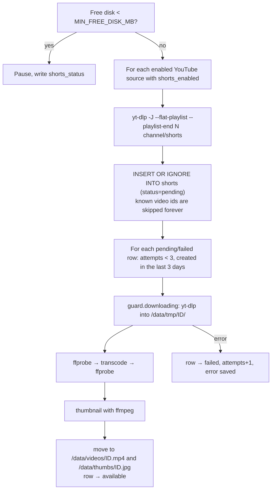

# Feeds and Shorts internals

How content gets into the database: adding sources, fetching feeds (including Reddit), downloading and
converting Shorts, and deleting old video files.

- [Adding a source](#adding-a-source)
- [Fetching feeds](#fetching-feeds)
- [Reddit](#reddit)
- [Parsing and sanitizing](#parsing-and-sanitizing)
- [SSRF protection](#ssrf-protection)
- [Shorts pipeline](#shorts-pipeline)
- [Retention and reconciliation](#retention-and-reconciliation)
- [yt-dlp updates](#yt-dlp-updates)

---

## Adding a source

`POST /api/sources` → `sources.add_source()` → `feeds.classify_input()` decides what the text is:

| Input | Classified as | Result |
|---|---|---|
| `r/name`, `name` (2–21 word chars), `reddit.com/r/name/...` | `reddit` | Source with `feed_url=https://www.reddit.com/r/name/.rss`, no network call |
| `@handle`, `UC…` channel id, `youtube.com/@x`, `/channel/UC…`, `/c/x`, `/user/x`, a channel's `feeds/videos.xml` | `youtube` | yt-dlp resolves the channel id and title (`shorts.resolve_channel`); `feed_url` = the channel's video RSS |
| anything else | `url` | `feeds.discover_feed()`: fetch it; if it's a feed, use it; if it's HTML, follow `<link rel="alternate" type="…rss/atom…">`; the first entries are stored immediately |

Duplicates are detected by `feed_url` (case-insensitive for Reddit) or `channel_id`. Re-adding a deleted
(archived) source re-enables it. Topics come from the starter list or are guessed from the title/description.
After creating, the API starts a background feed fetch, and for YouTube a Shorts run for that channel.

## Fetching feeds

`feeds.refresh_all()` runs every `RSS_INTERVAL_MIN` and on demand. It selects enabled sources with
`rss_enabled=1`, a `feed_url`, and `kind != 'demo'` (user posts have no `feed_url`, so they're skipped), ordered
by id.

- **Non-Reddit sources** (and any single-source refresh): `fetch_source()`:
  1. Skip if `backoff_until` is in the future.
  2. `safe_get(feed_url)` with `If-None-Match` / `If-Modified-Since` from the last response. 304 → mark OK, done.
  3. Parse, then `_store_entries()`: `INSERT OR IGNORE` each entry (unique on `(source_id, guid)`), update status,
     ETag, Last-Modified, icon, site URL.
- **Reddit sources** are grouped and fetched with `fetch_reddit_batch()` (next section).
- Then, if `RSS_RETENTION_DAYS > 0`, `prune_old_items()` deletes old items that have no comments, no reactions,
  and are not user posts.

**Backoff** (`_record_failure()`): every failure increments `error_count` and sets `status`, `last_error` and
`backoff_until`:

| Failure | Status | Wait before the next try |
|---|---|---|
| HTTP 429 | `rate_limited` | `max(Retry-After, 10 min × 2^(n−1))`, max 6 h |
| HTTP 403 from both Reddit hosts | `blocked` | 30 min × 2^(n−1), max 12 h |
| Anything else, 1st time | `error` | none (next scheduled run) |
| Anything else, n ≥ 2 | `error` | 20 min × 2^(n−2), max 6 h |

A success resets everything. The *Refresh* button and re-enabling a source clear `backoff_until`.

## Reddit

Reddit is the touchiest source: anonymous RSS is limited to a few requests per minute per IP, and some IPs are
blocked outright. Measures, all in [app/feeds.py](../app/feeds.py):

1. **Batching** (`fetch_reddit_batch`): up to `REDDIT_BATCH_SIZE` (default 4) subreddits per request:
   `https://www.reddit.com/r/linux+selfhosted+homelab+proxmox/.rss?limit=100`. The entries are split back to their
   sources by the Atom `<category term="subreddit">`, falling back to the `/r/<name>/` part of the post link.
   Matching is case-insensitive. Each source in the batch is then marked OK (even with zero new posts).
   - A batch of one uses the normal single fetch (with ETag).
   - If the batch gets 429/403, **every** source in it gets the backoff.
   - If it fails any other way (e.g. one subreddit was banned and Reddit returns 404 for the combination), it falls
     back to fetching each subreddit on its own, so one bad subreddit can't break the others.
   - Trade-off: 100 posts are shared, so a very busy subreddit can crowd out a quiet one in the same batch.
2. **Throttle**: `reddit_throttle` keeps at least 3 s between Reddit requests across all threads.
3. **User-Agent**: `linux:localds:<version> (by /u/REDDIT_USERNAME)`, the format Reddit's API rules ask for.
4. **Fallback host**: on 403 from `www.reddit.com` it retries `old.reddit.com`.
5. **Footer cleanup**: Reddit's "submitted by … [link] [comments]" footer is stripped from content.

Discover's subreddit search uses `https://www.reddit.com/subreddits/search.json` through `safe_get`.

A future improvement would be Reddit OAuth (app-only, ~100 requests/minute). It is listed in `CLAUDE.md` under
ideas.

## Parsing and sanitizing

`parse_feed()` uses **feedparser** for RSS 0.9x/1.0/2.0, Atom and JSON Feed-ish inputs, capped at 200 entries.
For each entry:

- `guid` = entry id, else link, else a hash of title + date.
- `published_at` = published/updated/created date, clamped to now (no future-dated posts at the top).
- `content_html` = `sanitize.clean_html()` of the content or summary.
- `excerpt` = first ~320 chars of plain text.
- `image_url` = media thumbnail/content, enclosure, or the first `` in the content.
- Reddit: `preview.redd.it/<name>.(jpg|png|webp)?width=…` previews (140/640 px, signed so the size can't be
  changed) are rewritten to the full-size original `i.redd.it/<name>` in both `image_url` and `content_html`
  (`sanitize.full_reddit_images`). GIFs and `external-preview.redd.it` are left alone. Items stored by older
  versions are rewritten once by `db._upgrade_reddit_images` (kv flag `reddit_full_images`).
- `category` = first `<category term>` (used for Reddit batches).

**Sanitizer** ([app/sanitize.py](../app/sanitize.py)): it does not clean the input HTML; it **re-renders** it from
scratch with BeautifulSoup, writing out only what is allowed:

- Allowed tags: `p, br, a, ul, ol, li, blockquote, pre, code, em, strong, b, i, h1–h6, img, figure, figcaption,
  hr`. `h1`/`h2` become `h3`.
- Dropped together with their content: `script, style, iframe, object, embed, form, noscript, svg, template, head,
  title`.
- Other tags are unwrapped (their text is kept); `div/section/article` become `
`.
- **No attributes are copied.** Links get only a safe `href` plus `target="_blank" rel="noopener noreferrer
  nofollow"`; images get only `src`, `alt`, `loading="lazy"`, `referrerpolicy="no-referrer"`. URLs are made
  absolute and must be `http(s)`.
- All text is HTML-escaped. Input is capped at 200 000 characters.

This HTML is the **only** thing the frontend inserts with `innerHTML`.

User posts don't go through feedparser: their text is HTML-escaped and wrapped in `
`/` ` by `_text_html()`
in `api_feed.py`.

## SSRF protection

Users can paste any URL, and the server fetches it. Without protection, someone could make the server read your
router admin page or other homelab services. [app/urlsafe.py](../app/urlsafe.py):

- `normalize_url()`: only `http`/`https`, no credentials in the URL, no whitespace/control chars, ≤2048 chars.
- `check_host()`: rejects `localhost`, `.local`, `.lan`, `.internal`, `.home.arpa`, …, and resolves the hostname:
  **every** resolved address must be public (not private, loopback, link-local, multicast, reserved, CGNAT;
  IPv4-mapped IPv6 is unwrapped).
- `safe_get()`: follows redirects **manually**, re-validating every hop; 15 s timeout; aborts above 8 MB.

`ALLOW_PRIVATE_URLS=true` skips the host checks (for LAN feeds). yt-dlp calls take channel/video URLs that were
validated or built from validated ids.

## Shorts pipeline

`shorts.fetch_all_shorts()` runs every `SHORTS_INTERVAL_MIN` (and for a single new channel right after adding it).
Only one full run at a time (`_fetch_lock`).

**Download** (`download_short`): `yt-dlp -f "bv*+ba/b" -S "res:<MAX_HEIGHT>,vcodec:h264,acodec:aac,ext:mp4:m4a"
--merge-output-format mp4 --max-filesize 300M --write-info-json`. The info JSON provides title, channel and upload
time. Plus any `YTDLP_EXTRA_ARGS`. Timeout 10 min.

**Transcode** (`transcode`), always ending in an iOS-friendly MP4 with `-movflags +faststart` (the index at the
start of the file, so playback starts before the download completes):

| Case | Command | Cost |
|---|---|---|
| Already H.264 and short side ≤ `MAX_HEIGHT` | `ffmpeg -c:v copy`, audio copied (or AAC 128k) | **remux**, nearly free |
| Needs re-encode, VAAPI available | `h264_vaapi -qp 24`, `scale_vaapi` | iGPU |
| Otherwise, or VAAPI failed | `libx264 -preset veryfast -crf 23 -profile high -level 4.0 -pix_fmt yuv420p` | CPU |

Scaling keeps the aspect ratio and makes the **short side** at most `MAX_HEIGHT`.

**Thumbnail**: one frame at 1 s (or 0 s), scaled to 360 px wide, JPEG.

The work folder `/data/tmp/<id>/` is always removed afterwards. Downloads stop mid-run if disk space runs low.

## Retention and reconciliation

[app/retention.py](../app/retention.py). Runs at startup and hourly.

**`cleanup()`**: for each `available` Short downloaded more than `RETENTION_DAYS` ago:
`expire_short()` deletes the video (and preview) file, keeps the thumbnail unless `KEEP_THUMBNAILS=false`, and
sets `status='expired', file_path=NULL, expired_at=now`. The row, comments and reactions stay. If
`KEEP_THUMBNAILS=false`, thumbnails of already-expired Shorts are removed too.

**`reconcile()`** makes disk and database agree:

- `available` rows whose file is missing → `expired` (never re-downloaded).
- Video files without an `available` row → deleted (orphans).
- Thumbnails not referenced by any row → deleted.
- `/data/tmp` leftovers → deleted if older than an hour or if nothing is downloading.

**Files in use are never touched**: `locks.guard` tracks downloads in progress and streams. A video counts as in
use while a request is streaming it **and for 180 s after the last request** (phones fetch videos in many small
Range requests, so a short gap must not look idle).

## yt-dlp updates

YouTube changes often break yt-dlp; fixes ship quickly. The image installs yt-dlp into a virtualenv owned by the
app user, so the app can `pip install -U "yt-dlp[default]"` itself without root: daily and 30 s after start
(`update_ytdlp`, can be disabled with `YTDLP_AUTO_UPDATE=false`). The version is stored in `kv` and shown on the
Admin page. A rebuilt image starts with the latest yt-dlp again.
